# Awesome Computational Photography & Film Simulation 📷🎞️

  

  
  
  
  
  
  
  

---

### 🌟 Top Computational Photography, Analog Film Emulation & RAW Color Science Ecosystem

**A curated, production-ready directory of commercial SaaS / hosted suites, desktop color-grading plugins, and top open-source GitHub repositories.**  
*Engineered for analog film emulation (Kodak, Fujifilm, Ilford, CineStill, Agfa), 3D LUT color transforms, HaldCLUT generation, RAW sensor demosaicing, optical halation synthesis, photochemical grain modeling, and computational imaging pipelines.*

> 📅 **Last updated:** November 2026

---

## 📑 Table of Contents
- [📊 Sector Overview & Market Dynamics](#-sector-overview--market-dynamics)
- [💼 SaaS & Commercial Platforms](#-saas--commercial-platforms)
- [🔓 Open-Source GitHub Projects](#-open-source-github-projects)
- [💡 Frameworks & Custom Pipelines](#-frameworks--custom-pipelines)
- [🤝 How to Contribute](#-how-to-contribute)
- [💖 Support & Share](#-support--share)
- [📈 Star History](#-star-history)
- [⚠️ Disclaimer](#️-disclaimer)

---

## 📊 Sector Overview & Market Dynamics

The global computational photography and digital image processing market is currently estimated between **$17 billion and $24 billion** (with dedicated photo editing and color grading software accounting for **$1.5B – $4.4B**), expanding at an annual growth rate of 10%–14% driven by mobile sensor fusion and advanced color appearance modeling. 

The sector is **moderately fragmented**: broad consumer and enterprise workflow platforms exhibit concentrated power dominated by incumbents like Adobe, while high-fidelity analog film emulation, 3D LUT mathematical modeling, and optical photochemical simulation remain heavily fragmented among specialized boutique software developers, custom plugin vendors, and passionate open-source imaging scientists.

---

## 💼 SaaS & Commercial Platforms

Below is a breakdown of leading commercial platforms, SaaS suites, and precision film simulation engines, sorted by parent company valuation / annual revenue (descending).

| Platform / Product | Company Size / Valuation / Revenue | Starting Pricing Tier | Free Tier Limits / Trial Period | Core Capabilities & Key Differentiators |
| :--- | :--- | :--- | :--- | :--- |
| **[Adobe Lightroom](https://adobe.com)** | **$85B – $95B Market Cap** (~$23.8B Ann. Revenue) | $11.99/month (Lightroom 1TB Annual Plan) | **7-day free trial**; full access to cloud syncing and editing; requires payment method upfront; 14-day refund guarantee | Industry-standard cloud-synced RAW photo development, AI adaptive masking, custom camera profiles, and massive third-party film preset support. |
| **[Capture One](https://captureone.com)** | **~$234M Acquisition Valuation** (Private Equity portfolio) | $14.99/month (Billed annually) or $299 perpetual license | **7-day free trial**; full feature access across tethered shooting and color grading; requires signup | Professional-tier RAW processing, custom sensor ICC color profiles, advanced three-way color wheels, and studio tethering workflows. |
| **[VSCO (Visual Supply Company)](https://vsco.co)** | **~$550M Valuation** (~$34M Ann. Revenue) | $12.99/month or $59.99/year (VSCO Pro) | **Free forever tier** (VSCO Starter: limited to 15 base presets and basic adjustments); **7-day free trial** for VSCO Pro | Pioneer in mobile computational photography, film presets (Kodak Portra, Fuji 400H, Ilford HP5), optical grain simulation, and creator portfolio tools. |
| **[DxO FilmPack](https://dxo.com)** | **~$25M – $50M Valuation** (~$16.8M Ann. Revenue) | $139.00 one-time perpetual license | **30-day fully functional free trial**; no credit card required; full access to all simulated film profiles; software stops upon expiry | Lab-profiled analog film simulation software recreating 80+ historic film stocks using proprietary micro-contrast and spectral grain density modeling. |
| **[Nik Collection](https://dxo.com)** | **~$25M – $50M Valuation** (~$16.8M Ann. Revenue) | $159.99 one-time perpetual license | **30-day fully functional free trial**; unrestricted access to all 8 plugins (including Silver Efex Pro and Analog Efex Pro); no credit card needed | Legendary suite of creative photography plugins dedicated to vintage camera optics, darkroom toning, and world-class B&W silver-halide conversion. |
| **[Dehancer](https://dehancer.com)** | Boutique Private (~$5M – $12M Est. Valuation) | $13.00/month (Photo plan, billed yearly at $156) or $449 perpetual license | **Indefinite free trial**; fully functional with all 60+ film stocks, halation, bloom, and grain enabled; exports contain an automatic Dehancer watermark and disables LUT export | Film-physics simulation engine with accurate photochemical emulation, optical bloom, real halation, film breathe, and print paper simulation. |
| **[Exposure X7](https://exposure.software)** | Boutique Private (~$4M – $10M Est. Valuation) | $129.00 one-time perpetual license | **30-day free trial**; fully functional standalone and plugin workflows; full access to 500+ film presets; no credit card required | Non-destructive RAW editor featuring hundreds of analog film emulations, vintage light leaks, darkroom grain, and selective masking. |
| **[FilmConvert Nitrate](https://filmconvert.com)** | Boutique Private (~$3M – $8M Est. Valuation) | $79.00 – $149.00 one-time perpetual license (3 seats) | **Indefinite free trial**; unrestricted access to all camera packs and film stocks; exports and preview frames stamped with watermark until licensed | Camera-profiled film simulation matching digital sensor responses to legendary motion picture and still photographic stocks. |
| **[RNI All Films (Really Nice Images)](https://reallyniceimages.com)** | Boutique Private (~$2M – $6M Est. Valuation) | $96.00 one-time purchase (RNI All Films Lite) / $192.00 (Pro) | **Free demo pack** available indefinitely (curated subset of film presets and profiles with 0 cost checkout); no time-limited trial for full Pro | Meticulous analog film profiles crafted directly from authentic negative/slide film scans for Adobe Lightroom, ACR, and Capture One. |

---

## 🔓 Open-Source GitHub Projects

Explore the most popular open-source software, computational color engines, RAW developers, and film simulation tools, sorted by GitHub stargazers count (descending).

| Repository / Project | GitHub_Stars & Community | Description & Capabilities |
| :--- | :--- | :--- |
| **[adobe/react-spectrum](https://github.com/adobe/react-spectrum)** |  | Adobe's collection of accessible UI libraries including React Aria for building computational photo viewers, web-based image manipulation tools, and color pickers. |
| **[darktable-org/darktable](https://github.com/darktable-org/darktable)** |  | High-performance open-source photography workflow application and RAW developer with scene-referred 3D LUTs (`lut3d`), `filmic rgb`, color calibration, and grain modules. |
| **[CyberTimon/RapidRAW](https://github.com/CyberTimon/RapidRAW)** |  | A fast, non-destructive, and GPU-accelerated RAW image editor built in Rust and Web tech with real-time film LUT grading and responsive rendering. |
| **[NatronGitHub/Natron](https://github.com/NatronGitHub/Natron)** |  | Open-source node-based compositing software supporting OpenColorIO, ACES color management, 3D LUT transforms, and film grain simulation. |
| **[Beep6581/RawTherapee](https://github.com/Beep6581/RawTherapee)** |  | Powerful cross-platform RAW photo processing engine with native HaldCLUT Film Simulation support, CIECAM02 color modeling, and wavelet decomposition. |
| **[colour-science/colour](https://github.com/colour-science/colour)** |  | Comprehensive Python package for computational color science, spectral film-curve modeling, Hurter–Driffield density functions, and 3D LUT generation. |
| **[OpenImageIO/oiio](https://github.com/OpenImageIO/oiio)** |  | High-performance API and toolset for reading, writing, and processing images and color conversions in VFX, film, and computational imaging pipelines. |
| **[AcademySoftwareFoundation/OpenColorIO](https://github.com/AcademySoftwareFoundation/OpenColorIO)** |  | Complete color management framework for visual effects, animation, and photography; powers ACES and filmic tone-mapping across production pipelines. |
| **[LibRaw/LibRaw](https://github.com/LibRaw/LibRaw)** |  | Industry-standard open-source library for extracting and demosaicing RAW image data from over 1,000 digital camera models. |
| **[lensfun/lensfun](https://github.com/lensfun/lensfun)** |  | Open-source photographic library and database for correcting optical lens distortion, chromatic aberration, and vignetting before film emulation. |
| **[ampas/aces-core](https://github.com/ampas/aces-core)** |  | Academy Color Encoding System (ACES) core transforms, color spaces, and reference rendering transforms for film and motion imaging. |
| **[KDE/digikam](https://github.com/KDE/digikam)** |  | Advanced open-source digital photo management (DAM) and RAW photo editing application with built-in film-style tone curves and B&W film simulation. |
| **[CarVac/filmulator-gui](https://github.com/CarVac/filmulator-gui)** |  | Unique RAW editor that models the physics and chemistry of silver-halide film emulsions during wet development, producing organic highlight roll-off. |
| **[artpixls/ART](https://github.com/artpixls/ART)** |  | Streamlined, modern RAW image processor forked from RawTherapee with fast local editing masks, CTL color scripts, and HaldCLUT film emulation. |
| **[jcelaya/hdrmerge](https://github.com/jcelaya/hdrmerge)** |  | Open-source computational photography tool that combines multiple bracketed RAW exposures into an extended-dynamic-range 32-bit floating point DNG. |
| **[hngseries/mfilm-canon-film-simulation](https://github.com/hngseries/mfilm-canon-film-simulation)** |  | M-Film in-camera film simulation for Canon EOS cameras via Magic Lantern, packing 68 authentic film stock profiles (Portra, Velvia, Tri-X, CineStill). |
| **[ilia3101/MLV-App](https://github.com/ilia3101/MLV-App)** |  | All-in-one cross-platform RAW video processing app with debayering, dual-ISO blending, 3D LUT application, and film color rendering. |
| **[sobotka/AgX](https://github.com/sobotka/AgX)** |  | Modern scene-referred filmic color transform and display rendering transform providing natural highlight desaturation and analog film-like roll-off. |
| **[GreycLab/gmic](https://github.com/GreycLab/gmic)** |  | Full-featured image computing framework bundling 300+ community HaldCLUT film stock emulations usable via CLI, GIMP, Krita, and Photoshop plugins. |

---

## 💡 Frameworks & Custom Pipelines

Combine these open-source and commercial building blocks to architect specialized imaging workflows:
- **Desktop Analog Darkroom:** Combine **Darktable** or **RawTherapee** with **G'MIC HaldCLUTs** for accurate negative and slide film reproduction with zero subscription cost.
- **In-Camera Vintage Shooting:** Flash **hngseries/mfilm-canon-film-simulation** with Magic Lantern onto supported Canon DSLR/mirrorless bodies for real-time film stock color science right in the field.
- **Cinematic Production & VFX:** Deploy **OpenColorIO (OCIO)** and **ampas/aces-core** alongside **Natron** for color-managed highlight roll-off and AgX display transformations.
- **Algorithmic Color Modeling:** Use **Colour Science for Python** to generate custom 1D/3D `.cube` LUTs, simulate spectral sensitivity curves, and evaluate chromatic adaptations.

---

## 🤝 How to Contribute

Contributions are welcome! To contribute:
1. 🍴 Fork the repository.
2. 📝 Add or update entries in `README.md` following the established table format.
3. 🔗 Verify that all links are active, pricing tiers are exact, and Stars_Badge links point to repository stargazers.
4. 🚀 Submit a Pull Request detailing your additions or improvements.

---

## 💖 Support & Share

Thank you for exploring and supporting this project! If you find this curated collection of computational photography tools and analog film simulations useful, please consider:

- ⭐ **Star this repository** to help other photographers and developers discover it.
- 🍴 **Fork and Share** it with your community on Reddit, Twitter/X, and LinkedIn.
- ☕ **Buy me a coffee / Sponsor** to support ongoing maintenance and new entries:  
  👉 **[GitHub Sponsor Dashboard](https://github.com/sponsors/ishandutta2007)**

---

## 📈 Star History

---

## ⚠️ Disclaimer

- This repository is a community-curated educational and informational resource.
- All product names, logos, trademarks, and registered film stocks (including Kodak, Fujifilm, Ilford, Agfa, and CineStill) belong to their respective copyright holders.
- When applying heavy 3D LUT transforms or film grain algorithms, always capture images in uncompressed / lossless RAW formats (.CR3, .ARW, .NEF, .RAF, .DNG) to preserve dynamic range and avoid 8-bit quantization banding.

---

  <b>Built with ❤️ for photographers, cinematographers, color scientists, and computational imaging engineers.</b>

